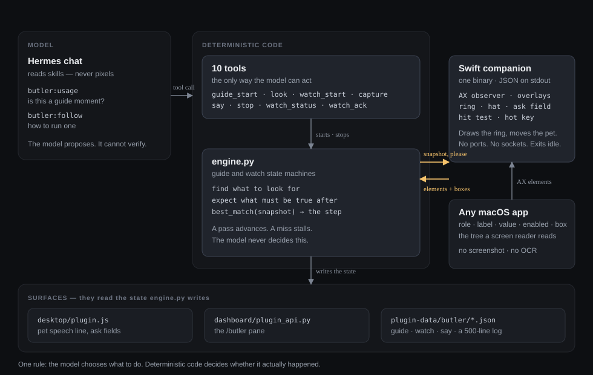

# Butler

[](https://github.com/Intenzi/hermes-butler)
[](LICENSE)
[](https://github.com/Intenzi/hermes-butler#requirements)
[](https://github.com/Intenzi/hermes-butler/releases)

Butler turns the pet already sitting in Hermes into an operator. Ask for help in
plain language and it plans a short guide, rings the real control on your screen,
says one line about it, and waits — moving on only when the macOS Accessibility
layer confirms the step actually landed. A click that did not land stalls the
guide instead of being counted. It works with any petdex pet, installs nothing
into your apps, and never types or clicks for you. The best part? Butler does this without vision.


## Install

```bash
hermes plugins install butler        # catalog
# dev install instead: hermes plugins install file:///path/to/butler-plugin
hermes gateway restart               # the plugin loads with the gateway
```

Quit and reopen the Hermes desktop app afterwards: the desktop half is copied
into `desktop-plugins/butler/` at startup, and a running app keeps the copy it
started with.

First use downloads the ~1.2 MB universal arm64+x86_64 screen helper from this
repository's attested GitHub release — published by CI with
`actions/attest-build-provenance` — and verifies it against the release's
SHA-256. No compiler needed. If the download fails and Command Line Tools are
installed, Butler compiles the bundled Swift source instead (7–14 s). See
[docs/](docs) for the build and provenance detail.

## What you get

Three things, all from the same pet.

## Guide
**Ask for help with a task.** The pet rings the next thing to click, says one
line about it, and stays there until the screen actually changes. Click the wrong
thing and it waits — it does not pretend you are done and it does not move on to
step two.


## Look
**Point at something and ask about it.** Right-click the hat beside the pet, then
click whatever you are curious about. Butler tells you what that control is, what
it does, and why it might be greyed out — and the click never reaches the app
underneath, so nothing fires by accident. The cursor becomes a crosshair while
you pick; `Esc` or a right-click cancels. The hat sits beside the **popped out**
pet, so pop it out of the Hermes window first.


## Watch
**Tell it to watch for one thing.** "Tell me when the build finishes." You go and
do something else; when it happens the pet says so, and keeps saying so until you
acknowledge it. Not a notification that scrolls away — a line that waits for you.


All three work the same way underneath: Butler reads the on-screen element data
that macOS already publishes, the same information a screen reader uses. No
pictures, no OCR, no model looking at your screen.


## Requirements

- macOS 13 or later; Apple silicon or Intel.
- Hermes Agent 0.22.5+ with the desktop app (that is where the pet and the hat live).
- One macOS permission: Accessibility, granted to Butler's bundled helper, plus
  one app restart. `hermes butler doctor --ask` raises the real dialog.

## Safety & privacy

- **Accessibility only.** No screenshots, no OCR, no Screen Recording, no Input
  Monitoring. Butler reads element text and geometry boxes, nothing else.
- **Nothing leaves the machine** except what the chat's own model provider
  already receives. No telemetry, no auto-updater.
- **One download, ever.** The attested helper from this repository's release,
  SHA-256 verified. Refuse it with `BUTLER_NO_DOWNLOAD=1` and it will compile the
  bundled source locally when it can.
- **Guide-only by design.** Butler never types, clicks, or edits your files; it
  shows and verifies. A guide refuses to start under an unattended run, so a
  cron session cannot become a background screenreader.
- **Bounded state.** One guide and one watch at a time; runtime writes stay in
  `plugin-data/butler/` and `desktop-plugins/butler/` (the watch log is capped at
  500 lines).

## Performance

Measured on my machine (macOS 26.3, Apple silicon) with a live companion — not
estimates:

- **No vision model anywhere.** The screen is never rendered to an image and
  never sent to a model to be interpreted. Butler reads the same structured
  element data a screen reader uses, so results come back in milliseconds, work
  without a network round-trip, and add nothing to your token spend.
- **Idle is idle.** 0.0% CPU and ~59 MB resident after 80 minutes running. There
  is no frame loop in the companion and nothing redraws unless a guide is on
  screen.
- **Placement is event-driven, not polled.** The hat tracks the pet from
  Accessibility move notifications, coalesced to one placement per 40 ms. A
  single drag emits 86 of them, roughly 17 ms apart.
- **Missed events heal on a slow tick.** A 3 s reconciliation pass covers windows
  created while the observer was not running; without notifications the same code
  falls back to a 0.5 s poll, so the badge is never stranded.
- **The overlay only touches style when it moves.** The click target follows the
  pet canvas each animation frame but writes to `style` only when the rectangle
  changes by more than half a pixel — no layout thrash while dragging.
- **A watch costs one tree walk per 3 s**, and nothing at all when no watch is
  armed.

## Under the hood

Four moving parts, one rule: **the model decides what to do, deterministic code
decides whether it actually happened.**



| Part | What it is |
|---|---|
| `butler_core/engine.py` | The guide and watch state machines. Turns an intent into steps, asks for snapshots, evaluates each step's `expect`, and writes the spool the pet and the pane read. |
| `butler_core/overlay_swift/ButlerOverlay.swift` | A single-file Swift companion — Accessibility observers, the ring, the hat, the ask field, the click-catcher, the hot key. ~7.9k lines, no dependencies. |
| `desktop/plugin.js` | The Desktop SDK half: the pet's speech line, the summon and ask fields, and the polling that closes the loop back into the chat. |
| `dashboard/plugin_api.py` | The `/butler` pane: start and stop a watch, guide history, the live transcript. |

**The path of one request**

1. A skill decides whether this is a guide moment at all (`butler:usage`), and how to run one (`butler:follow`). Both are prose loaded into the model's context — no logic, no privileges.
2. `butler_guide_start` hands the engine a plan: each step carries a `find` (what to look for) and an `expect` (what must be true afterwards).
3. The engine asks the companion for a snapshot of that app's Accessibility tree — a shallow walk first, then one re-walk to depth 24 when the app is Electron.
4. `best_match` picks the element from the snapshot; the companion draws the ring on it and moves the pet beside it.
5. The next snapshot is judged against `expect`. A pass advances the step. A miss stalls the guide and resets its clock — it does not tick, and it does not invent a new instruction.

**Calls, and how a request reaches the model.** The three doors are framed
turns — `[butler summon]`, `[butler look]`, `[butler watch]` — and a typed
`watch <app> for …` routes to the watch frame. A watch is armed with
`butler_watch_start`, inspected with `butler_watch_status` and cleared with
`butler_watch_stop`; the pane shows `⏲ Watching <app> · <N> changes`.

**What the Accessibility tree gives, and what it costs.** Role, label, value,
enabled state and a geometry box for every element an app publishes. No pixels,
no screenshot, no model call to interpret an image — a screen reader sees more
than a vision model here, and it sees it in milliseconds for free.

**The companion is a process, not a daemon.** One Swift binary per Hermes
process, speaking JSON lines over stdout. No ports, no sockets, no background
service; it exits when nothing is watching and the pet is gone.


## Troubleshooting

- **The helper didn't download.** Run `hermes butler doctor`; its JSON says
  whether the overlay is present. Offline or behind a proxy, install Command Line
  Tools (`xcode-select --install`) so Butler compiles the bundled Swift source
  instead, or set `BUTLER_NO_DOWNLOAD=1` to skip the network attempt outright.
- **The guide says "Switch to <app>".** That step happens in another app and
  verification failed while yours was frontmost. Bring that app forward and the
  guide resumes; if the control moved, it stalls rather than counting the step.
- **The watch says baseline 0.** Nothing matched the author-role nodes when the
  watch armed — the view had not rendered yet, or the name does not match what AX
  exposes. Open the list, then rerun the watch again.

## Docs

- [docs/demo-script.md](docs/demo-script.md) — the 90-second walkthrough.
- [docs/evidence-where-is-it.md](docs/evidence-where-is-it.md) — the field
  evidence behind the "where do I find X" use case.
- [skills/](skills) — `butler:follow` (when to offer a guide), `butler:usage`
  (when to suggest one at all), `butler:conventions` (contributor rules).
- Tests: `pytest` and `npm test`.
- Screenshots live in `docs/img`.


## License

MIT — see [LICENSE](LICENSE).
